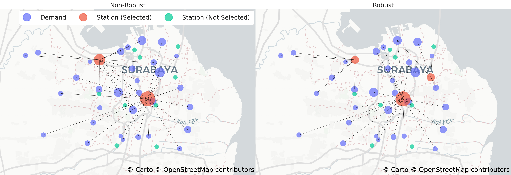
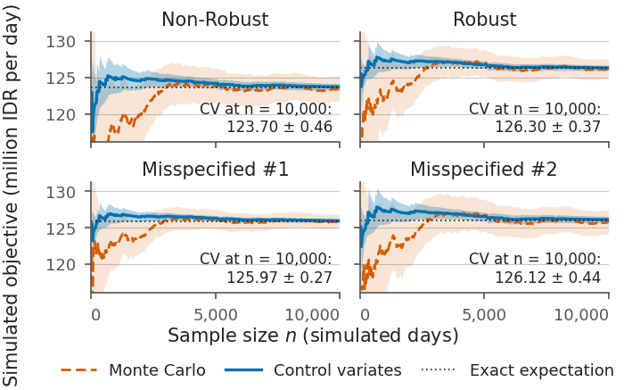
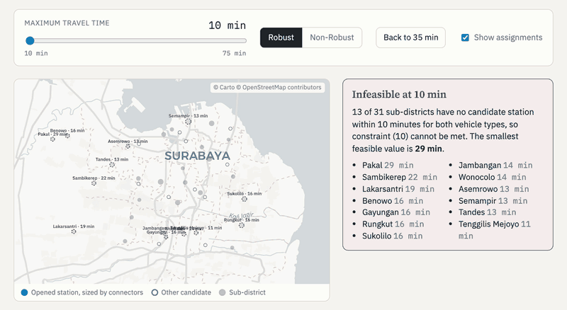

# Robust EV charging-station location under rare-event disruptions

[![CI][ci-badge]][ci-url]
[![Python][py-badge]][repo-url]
[![License: MIT][lic-badge]][lic-url]
[![Solver: HiGHS][highs-badge]][highs-url]
[![Paper: IEEM 2026][paper-badge]](#citation)
[![arXiv][arxiv-badge]][arxiv-url]

Code and data for the paper **"A Robust Electric Vehicle Charging Station Optimization
under Rare Event Disruptions"** (Y. P. Akhra, I. Vanany, M. M. Arief, IEEE IEEM 2026).

The model chooses where to open charging stations and how many connectors to install
when each station can lose power for a day. Station reliabilities are estimated by
simulation with a control variate, and they enter both the objective and the
service-level constraints of a mixed-integer program. The case study covers 11
candidate stations, 31 sub-districts and two vehicle types in Surabaya, Indonesia.

Maintained by the [AI Verification & Validation (AI V&V) Lab](https://ai-vnv.kfupm.io)
at King Fahd University of Petroleum and Minerals (KFUPM).

<p align="center">
  
</p>

## Quick start

```bash
git clone https://github.com/ai-vnv/rare-event-ev-charging.git
cd rare-event-ev-charging
pip install -e ".[test]"

pytest -q                      # 21 tests, a few seconds
python scripts/reproduce.py    # every table and figure, under a minute
```

Only open-source packages are needed (NumPy, SciPy, pandas, Matplotlib, Pillow, Pyomo
and the HiGHS solver). No commercial solver licence is required, and nothing reaches the
network: the basemap behind the maps is committed to `data/basemap/`.

## What the script reproduces

`scripts/reproduce.py` writes its output to `results/`. The committed copies were
produced with the default settings (10,000 simulated days, fixed seeds).

| Output | Content |
|---|---|
| `results/designs.csv` | the designs with expected cost, revenue, penalty and objective, backup coverage and mean travel time |
| `results/reliability.csv` | station reliabilities: exact, Monte Carlo and control variates |
| `results/objective_vs_n.csv`, `objective_final.csv` | simulated objective against sample size |
| `results/cv_sensitivity.csv` | variance reduction against the proxy correlation |
| `results/summary.json` | headline numbers quoted below |
| `results/figures/` | Fig. 2 (candidates), Fig. 3 (simulated objective), Fig. 4 (designs side by side), one full-size map per design, as PDF and PNG |

### Designs (million IDR per day, under the exact reliabilities)

| Design | Opened stations (connectors) | Cost | Revenue | Penalty | Objective | Backup | Travel |
|---|---|---:|---:|---:|---:|---:|---:|
| Non-Robust, worst tie-break | Embong Wungu (7), Tandes (4) | 11.03 | 149.03 | 14.40 | 123.60 | 45% | 20.8 |
| Non-Robust, best tie-break | Embong Wungu (8), Tandes (3) | 11.03 | 148.99 | 11.96 | 126.00 | 45% | 17.0 |
| **Robust** | Embong Wungu (7), Ploso (2), Tandes (2) | 12.09 | 148.99 | 10.64 | **126.26** | 74% | 15.1 |
| Misspecified #1 (outage probability doubled) | Embong Wungu (5), Ploso (2), Tandes (2), Karang Pilang (2) | 13.74 | 149.00 | 9.36 | 125.90 | 90% | 13.4 |
| Misspecified #2 (outage probability halved) | Embong Wungu (8), Tandes (3) | 11.03 | 148.99 | 11.96 | 126.00 | 45% | 17.0 |

*Backup* is the share of demand nodes with two or more opened stations within 35
minutes. *Travel* is the mean travel time to the charging station in minutes.

- The Robust design opens three stations where the Non-Robust design opens two. It costs
  9.7% more, shortens trips and leaves more demand nodes with a second station within
  reach. Revenue is unchanged because both designs serve all demand.
- The Non-Robust objective ignores travel time, so many assignments of vehicles to
  stations are equally profitable for it. `tie_break="worst"` and `"best"` return the
  two ends of that range. Against them, the Robust design lowers the expected penalty
  by **26% to 11%** and raises the expected objective by **2.1% to 0.2%**. The figures
  show the worst case.
- Both misspecified designs lose at most 0.3% of the Robust objective.

### Monte Carlo against control variates

<p align="center">
  
</p>

With a proxy correlation of 0.999, the control variate gives a standard error about
3.4 times smaller than Monte Carlo, which is about 12 times fewer simulated days for the
same precision. These are the theoretical values; the committed 10,000-day sample gives
3.7 and 13. At 10,000 days the Monte Carlo intervals of the Robust and Non-Robust designs
still overlap, while the control-variate intervals separate them.

## Use it on your own case

```python
from evcharging import OutageSimulator, cv_reliability, load_case, solve_design

case = load_case("path/to/your/data")        # same four files as in data/

draws = OutageSimulator(case, proxy_corr=0.999).sample(5_000, seed=0)
p_hat = {j: est.mean for j, est in zip(case.J, cv_reliability(draws))}

design = solve_design(case, p_hat)           # Robust Model
print(design.opened, design.expected(p_hat)["objective"])
```

The four input files are described in [`data/README.md`](data/README.md). A complete
example is in [`examples/quickstart.py`](examples/quickstart.py).

| Module | Purpose |
|---|---|
| `evcharging.data` | `load_case`, the `Case` container, `scale_outage` |
| `evcharging.model` | `solve_design`: objective (2) and constraints (4) to (13) in Pyomo |
| `evcharging.simulate` | `OutageSimulator`, Monte Carlo and control-variate estimators, `indicator_corr2` |
| `evcharging.plots` | the figures, including the map of the paper |
| `evcharging.basemap` | the cached Carto Positron basemap the maps are drawn on |

## The map of the paper

The maps are an exact redraw of the figure in the paper, which the original
[EVChargeSim](https://github.com/mansurarief/EVChargeSim) code produced with
`plotly.express.scatter_mapbox` on the Carto Positron basemap. The published figure is
an 800 x 520 pixel raster; segmenting its markers and fitting a Web Mercator view to the
eleven candidate stations recovers the Plotly call behind it:

| Setting | Value |
|---|---|
| Figure | 400 x 260 points, written at scale 2 |
| Zoom | 9.9, centred on the mean of the node coordinates |
| Colours | Plotly's `#636EFA`, `#EF553B`, `#00CC96` at 70% opacity |
| Marker area | demand `round(population / 10,000)`, station not selected `3`, station selected `5` per connector |
| Marker diameter | `23.6 * sqrt(area / largest area)` points |
| Assignment lines | black hairlines, drawn over the markers |

With that fit every station lands within 0.7 pixels of where the paper puts it, which
`tests/test_plots.py` checks on every run. The figures are redrawn in Matplotlib rather
than Plotly, so they come out as vector PDF and need neither a headless browser nor the
network.

`evcharging.plots.figure_map(case, design)` draws one map; `figure_designs` puts several
side by side on one common marker scale so the designs can be compared.

### Rebuilding the basemap

`data/basemap/surabaya_canvas.jpg` is committed, so this is only needed if the framing
changes. Carto has retired its raster tiles, so Positron is rendered once from vector
tiles with MapLibre in headless Chromium, which needs a free
[Carto API key](https://carto.com) and the optional `maps` extra:

```bash
pip install -e ".[maps]" && python -m playwright install chromium
CARTO_API_KEY=... python scripts/fetch_basemap.py
```

Without a key, `--provider esri` stitches Esri's World Light Gray Canvas instead, which
needs no key and no browser. Whichever provider is used, its attribution is stored
beside the image and printed in the corner of every map.

## Sensitivity to the maximum travel time

`scripts/sweep_travel_time.py` re-solves both models for every maximum travel time
`d_max` from 10 to 75 minutes and writes `results/travel_time_sweep.json`;
`scripts/build_interactive.py` turns it into `results/interactive.html`, a
self-contained page with a slider over `d_max` that shows the opened stations on the
map and the cost, revenue, penalty and objective as a percentage of the 35-minute
design. Below 29 minutes one sub-district (Pakal) has no candidate within reach and the
program is infeasible; from 41 minutes the Robust design drops Tandes and serves the
west from Embong Wungu alone.

<p align="center">
  <a href="results/interactive.html"></a>
</p>

GitHub shows `results/interactive.html` as source, so open the file locally, or serve it
from any static host (GitHub Pages: Settings, Pages, deploy from `main`, then
`/results/interactive.html`). The preview above is `results/figures/interactive_preview.gif`,
captured with "Show assignments" ticked by `scripts/make_preview.py` (needs Playwright).

```bash
python scripts/sweep_travel_time.py && python scripts/build_interactive.py
uv run --with playwright --with pillow python scripts/make_preview.py   # optional: redraw the GIF
```

## Modelling notes

These points are needed to reproduce the results and are stated here in one place.

1. **Existing station.** Embong Wungu, the utility's main charging station, is already
   in operation and is kept open in every design (`existing_stations` in
   `data/params.json`).
2. **Travel time by vehicle type.** The data give travel times for motorcycles and for
   cars, so the model uses `d[i, j, k]` where the paper writes `d_ij`.
3. **Reliabilities.** They follow from the masked demand model of Table I,
   `p_j = Phi((z_j - mu_j) / sigma_j)`, which gives 0.977 to 0.979 for all stations.
4. **Control variate.** The control is the outage indicator of a standard-normal proxy
   of the standardised demand, with known mean `Phi(kappa_j)`. The correlation between
   the proxy and the demand is a modelling assumption; the default is 0.999
   (`--proxy-corr`). The saving depends strongly on this value, as
   `results/cv_sensitivity.csv` shows: a correlation of 0.99 halves the standard error,
   and a tenfold reduction needs about 0.99999.
5. **Misspecification.** The misspecified models scale the outage probability
   `1 - p_j` by 2 and by 1/2. Scaling `p_j` itself by 1.05 would exceed one, and scaling
   it by 0.95 falls below the service level of 0.95, which makes constraint (13)
   infeasible.
6. **Non-Robust ties.** See the note under the table above.
7. **Assignment variables.** `y` is free whenever no constraint needs it, so a solver
   may switch on links that carry no vehicles. The figures and statistics therefore use
   the vehicle flows `v` and the opened stations, not `y`.
8. **Service-level constraints.** Constraints (12) and (13) are slack in all designs
   here, because every reliability stays above the service level of 0.95, even with the
   outage probability doubled.

### Relation to earlier versions

An earlier draft of this work (arXiv:2307.05470v1) reports a 13% higher objective for
the Robust Model and a standard error ten times smaller with control variates. Those
figures could not be reproduced from the model and data as stated. Under objective (2)
with the parameters of Tables I and II and Embong Wungu kept open, the best feasible
design attains 126.27 million IDR per day, so the gain over the Non-Robust design cannot
exceed 2.2%. The numbers in this repository are the ones the code produces.

## Repository layout

```
data/            Surabaya case: stations, demand, travel times, parameters, basemap
src/evcharging/  the package (data, model, simulate, plots, basemap)
scripts/         reproduce.py, fetch_basemap.py, sweep_travel_time.py,
                 build_interactive.py, make_preview.py
examples/        quickstart.py
results/         committed outputs of reproduce.py
tests/           pytest suite
```

## Citation

```bibtex
@inproceedings{akhra2026robust,
  author    = {Akhra, Yan Pratama and Vanany, Iwan and Arief, Mansur M.},
  title     = {A Robust Electric Vehicle Charging Station Optimization under Rare Event Disruptions},
  booktitle = {2026 IEEE International Conference on Industrial Engineering and Engineering Management (IEEM)},
  year      = {2026}
}
```

## License

Code is released under the [MIT License](LICENSE). The basemap is the Carto Positron
style over OpenStreetMap data; see [`data/README.md`](data/README.md) for data
provenance and attribution.

[ci-badge]: https://github.com/ai-vnv/rare-event-ev-charging/actions/workflows/ci.yml/badge.svg
[ci-url]: https://github.com/ai-vnv/rare-event-ev-charging/actions/workflows/ci.yml
[py-badge]: https://img.shields.io/badge/python-3.10%2B-blue.svg
[repo-url]: https://github.com/ai-vnv/rare-event-ev-charging
[lic-badge]: https://img.shields.io/badge/license-MIT-green.svg
[lic-url]: LICENSE
[highs-badge]: https://img.shields.io/badge/solver-HiGHS-orange.svg
[highs-url]: https://highs.dev
[paper-badge]: https://img.shields.io/badge/paper-IEEM%202026-lightgrey.svg
[arxiv-badge]: https://img.shields.io/badge/arXiv-2307.05470-b31b1b.svg
[arxiv-url]: https://arxiv.org/abs/2307.05470
